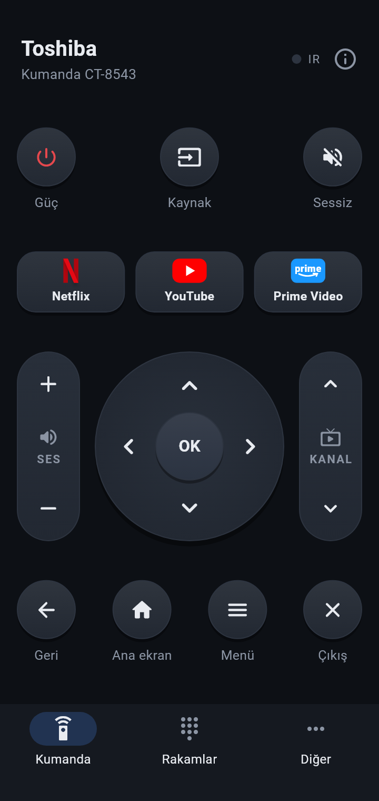
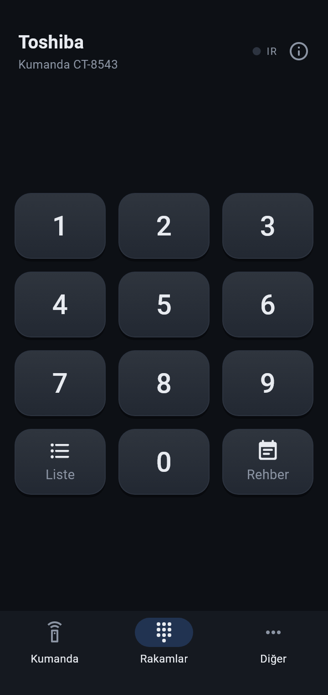
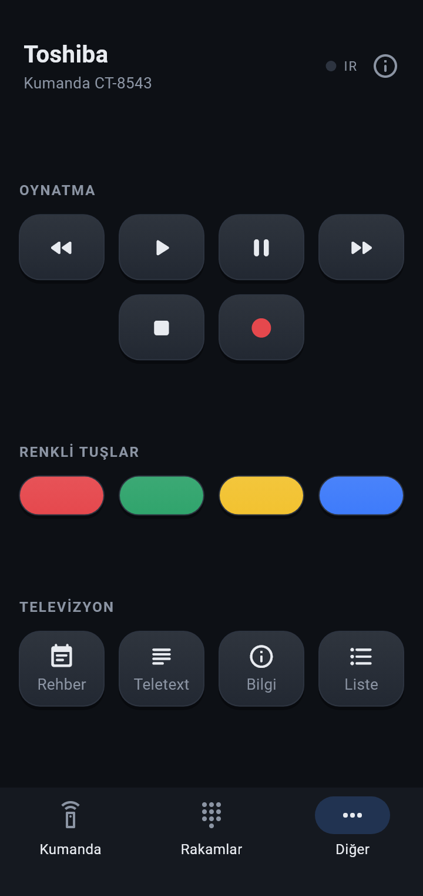

# IR Kumanda

Telefonun kızılötesi (IR) vericisini televizyon kumandasına çeviren Android uygulaması.
**Toshiba** televizyon ve orijinal kumandası **Toshiba CT-8543** için hazırlandı; tüm tuşlar gerçek TV üzerinde denendi.

<p align="center">
  
  
  
</p>

## Özellikler

- Orijinal kumandanın bütün tuşları: güç, kaynak, ses, kanal, yön tuşları, OK, geri, ana ekran, menü, çıkış, rakamlar, oynatma tuşları, renkli tuşlar, rehber, teletext, bilgi, kanal listesi
- Netflix, YouTube ve Prime Video tuşları uygulamayı doğrudan açar
- Ses, kanal, yön ve sarma tuşları basılı tutulunca gerçek kumanda gibi art arda gönderilir
- Tek elle kullanım için düzen: sık kullanılan tuşlar başparmak bölgesinde, güç tuşu yanlışlıkla basılmasın diye en üstte
- Küçük ve büyük ekranlara göre ölçeklenir; tuşlar her ekranda en az 44 dp dokunma alanında kalır
- Her basışta titreşim ve sinyal gittiğini gösteren "IR" ışığı
- IR vericisi olmayan telefonda ne olduğunu açıkça söyler
- İnternet izni yok, veri toplamaz; yalnızca IR gönderme izni kullanır

## Uyumluluk

**Telefon:** IR vericisi olan, Android 8.0 ve üzeri her telefon (Xiaomi, Redmi, POCO, Huawei, Honor, Vivo, iQOO vb.).
Telefonun IR vericisi genelde üst kenardadır; o kenarı televizyona doğrultun.

**Televizyon:** Toshiba CT-8543 kumandasıyla çalışan Toshiba televizyonlar (Vestel üretimi). Kumanda NEC protokolünü,
`0x40` cihaz adresiyle kullanıyor. Aynı kod ailesini kullanan diğer Toshiba televizyonlarda da büyük ölçüde çalışması
beklenir, ama yalnızca CT-8543 ile denendi.

## Kurulum

1. [Releases](../../releases) sayfasından `IR-Kumanda-x.y.z.apk` dosyasını telefona indirin.
2. Dosyayı açın; telefon "bilinmeyen kaynaklardan yükleme" izni isterse verin.
3. Uygulamayı açın ve telefonun üst kenarını televizyona doğrultun.

## Tuş kodları (NEC, adres 0x40, 38 kHz)

| Tuş | Kod | Tuş | Kod | Tuş | Kod |
|---|---|---|---|---|---|
| Güç | `0x12` | Yukarı | `0x19` | Netflix | `0x2A` |
| Kaynak | `0x14` | Aşağı | `0x1D` | YouTube | `0xD2` |
| Sessiz | `0x10` | Sol | `0x42` | Prime Video | `0x32` |
| Ses + | `0x1A` | Sağ | `0x40` | Ana ekran | `0x34` |
| Ses − | `0x1E` | OK | `0x21` | Menü | `0x5B` |
| Kanal + | `0x1B` | Geri | `0x64` | Çıkış | `0x43` |
| Kanal − | `0x1F` | Rehber | `0x45` | Bilgi | `0x16` |
| Teletext | `0x17` | Kanal listesi | `0x47` | Rakamlar 0–9 | `0x00`–`0x09` |
| Geri sar | `0x6C` | Oynat | `0x67` | Duraklat | `0x6A` |
| Durdur | `0x68` | İleri sar | `0x6B` | Kayıt | `0x6F` |
| Kırmızı | `0x48` | Yeşil | `0x49` | Sarı | `0x4A` |
| Mavi | `0x4B` | Rakuten TV* | `0xCE` | | |

\* Kumandada var, uygulamada gösterilmiyor.

Kodların tamamı [`app/assets/remotes/toshiba_ct-8543.json`](app/assets/remotes/toshiba_ct-8543.json) dosyasında.

### Kodlar nasıl bulundu?

Telefonların IR'si yalnızca vericidir, kumanda sinyalini okuyamaz. Bu yüzden:

1. Toshiba'nın NEC `0x40` kod ailesi açık veritabanlarından ([Flipper-IRDB](https://github.com/Lucaslhm/Flipper-IRDB),
   [IRDB](https://github.com/probonopd/irdb)) alındı ve televizyonda denendi.
2. Netflix, YouTube, Prime Video ve Ana ekran gibi tuşların kodları hiçbir veritabanında yoktu. Bunlar `ir-kopru` aracıyla
   256 komutun tek tek gönderilip televizyonun tepkisine bakılmasıyla bulundu.

## Proje yapısı

| Klasör | İçerik |
|---|---|
| `app/` | Flutter ile yazılmış Android uygulaması |
| `app/lib/ir/` | NEC kodlayıcı ve Android `ConsumerIrManager` köprüsü |
| `app/lib/remote/` | Kumanda profili (JSON) ve tuş gönderme mantığı |
| `app/lib/ui/` | Ekranlar ve tuş bileşenleri |
| `ir-kopru/` | Kod bulma aracı: telefonu yerel ağ üzerinden IR vericisi olarak kullanan küçük bir APK ve tarayıcı paneli |

## Derleme

Gerekenler: Flutter (stable) ve Android SDK.

```sh
cd app
flutter test
flutter build apk --release
```

Yayın imzası için `app/android/key.properties` dosyası oluşturun (`storeFile`, `storePassword`, `keyAlias`,
`keyPassword`). Bu dosya yoksa derleme debug anahtarıyla imzalanır. Anahtar dosyaları repoya eklenmez.

### ir-kopru (kod bulma aracı)

`ir-kopru/build.sh` Gradle olmadan küçük bir APK derler (Android SDK `build-tools` ve JDK yeterli). Telefonda açıkken
`http://<telefon-ip>:8765` adresinde bir panel sunar; panelden NEC/RC5/Pronto kodları gönderilebilir ve bir adresteki
bütün komutlar sırayla taranabilir. Uygulama ekranı açıkken aynı ağdaki herkes bu panele erişebilir; işiniz bitince kapatın.

## Lisans ve markalar

Kod [MIT lisansı](LICENSE) ile paylaşılmıştır.

Toshiba, Netflix, YouTube ve Prime Video adları sahiplerinin ticari markalarıdır; bu proje onlarla bağlantılı değildir.
Uygulamadaki uygulama simgeleri, tuşun neyi açtığını göstermek için kodla çizilmiş basit işaretlerdir.

---

## English

**IR Kumanda** is an Android app that turns a phone's built-in infrared blaster into a remote for **Toshiba** TVs that use
the **Toshiba CT-8543** remote (NEC protocol, address `0x40`). Every key was verified on a real TV, including the
Netflix, YouTube and Prime Video shortcuts, whose codes were found by scanning all 256 commands with the `ir-kopru` tool.
Requires an Android 8.0+ phone with an IR emitter. Download the APK from [Releases](../../releases). MIT licensed.
